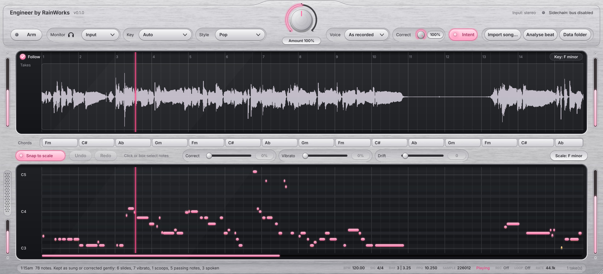
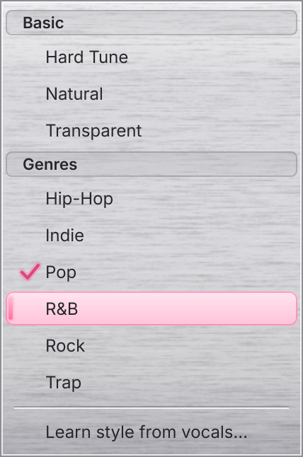
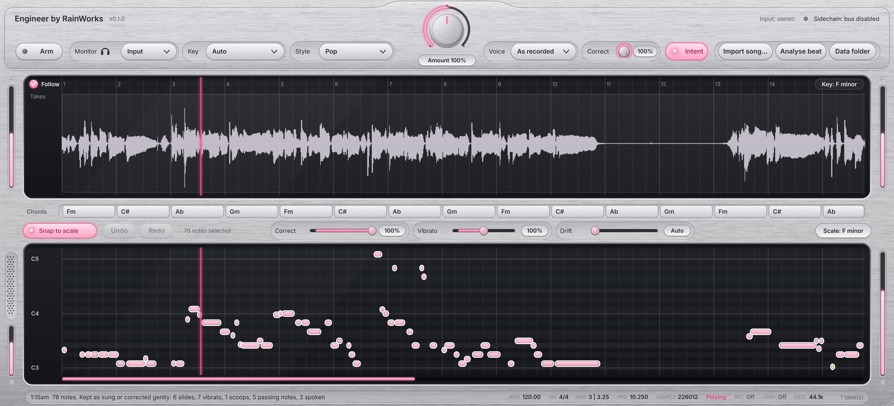

# Engineer by RainWorks

**Intelligent vocal tuning and styling for FL Studio.**
Drop in a vocal and your beat. Engineer finds every note, hears the key and chords in the beat, works out what
you meant to sing, and hands back a tuned, genre-styled take you can fine-tune note by note.

VST3 · Windows 64-bit · FL Studio

[Get it](#get-started) · [FL Studio guide](docs/FL-Studio-Guide.md) · [Feature reference](docs/Feature-Reference.md) · [Build from source](docs/Developer-Guide.md)

 

## Why Engineer

Most tuners make you pick a key and hope. Engineer listens first.

- **It knows the song.** Route your beat into the sidechain (or just drop the beat file in) and Engineer
  detects the key and the chord on every beat. Notes snap to *your* song's scale, not a guess.
- **It hears the singer.** A neural pitch tracker finds the note even on gritty, breathy or roomy takes, and a
  technique detector marks vibrato, belts, breathy lines, grit and rapped or spoken parts.
- **It keeps what you meant.** Intent reads each note before correcting it, so slides stay slides, vibrato
  stays yours, chosen blue notes stay blue, and rapped lines are left alone.
- **It sounds like a genre, not a plug-in.** Pick Rock, Pop, Indie, R&B, Hip-Hop or Trap and get that genre's
  pitch feel, movement, tone and compression in one move. Push it to 200% when you want it obvious.

## Features

<table>
<tr>
<td width="50%" valign="top">

### Neural pitch and technique detection
FCPE, a neural pitch tracker, reads the melody and a small classifier rates the technique every 10 ms
(vibrato, breathy, belt, grit, spoken/rapped). On the vocadito test set, octave errors on clean takes drop from
1.9% to 0.1%, and pitch accuracy in a reverberant room rises from 89.4% to 92.7%
([measurements](docs/Feature-Reference.md#12a-neural-pitch-and-technique-detection)).

</td>
<td width="50%" valign="top">

### Auto key and chords from the beat
Send the instrumental to the sidechain and Engineer fills a chord strip (major, minor, 7, sus2, sus4, dim) and
sets the key, which you can override at any time. No beat? Pick the key yourself.

</td>
</tr>
<tr>
<td valign="top">

### Intent: slides and vibrato preserved
Every note is read as a slide, scoop, held vibrato, passing note, chosen accidental, ad-lib, spoken line or
scream, and corrected accordingly. Right-click any note to see how it was read. Notes you edit by hand are
never second-guessed.

</td>
<td valign="top">

### Six genre styles, plus the basics

**Rock** (modern rock, pop-punk, emo, post-hardcore cleans), **Pop**, **Indie**, **R&B**, **Hip-Hop** and
**Trap**, plus **Natural**, **Transparent** and **Hard Tune**. Pop, Rock, Indie and R&B were
learned from openly licensed vocals; Hip-Hop and Trap are tuned by hand. Learn your own style
from reference vocals, or write one as a small JSON file.

</td>
</tr>
<tr>
<td valign="top">

### Graph editing
A full note graph: click, box-select or select every note at a pitch, drag in pitch or time with snap to
scale, split and merge notes, and set Correct, Vibrato and Drift per note. Full undo and redo, plus keyboard
shortcuts.

</td>
<td valign="top">

### Amount up to 200%
One big knob sets how strongly the style is applied: 0% is clean tuning only, 100% is the style as designed,
200% exaggerates it. The **Correct** knob sets how far notes are pulled to pitch.

</td>
</tr>
</table>

Also inside: whole-song import (drag in the vocal and beat, nothing has to play), punch-in capture while FL
plays, quantize and swing per style, sessions saved with your FL project, and GPU rendering of voice models through DirectML.

Graph mode: select notes, then drag, snap to scale or reshape vibrato and drift.

## Get started

1. **Download.** Open [Actions → build](https://github.com/dfato/rainworks-engineer/actions/workflows/build.yml),
   pick the newest green run on `main`, and download the **EngineByRainWorks-VST3-win64** artifact (sign in to
   GitHub first; artifacts expire after 90 days).
2. **Install.** Unzip it and copy the whole `Engineer by RainWorks.vst3` folder into
   `C:\Program Files\Common Files\VST3\`. It's a folder, not a single file, so keep it whole.
3. **Scan.** In FL Studio: *Options → Manage plugins → Find more plugins*. Engineer appears under Effects,
   from RainWorks.
4. **Load.** Put Engineer first on your vocal's mixer insert, before EQ, compression or reverb.
5. **Bring in a take.** Click **Import song...** and pick your dry vocal and your beat (both exported from bar
   1), or arm Engineer and record while FL plays.
6. **Hear it.** Pick a **Style**, set **Monitor** to **Rendered**, and press play.

A fresh instance starts with Correct at 0% and Monitor on Input, so nothing changes until you pick a style and
switch to Rendered. The [FL Studio guide](docs/FL-Studio-Guide.md) walks through routing the sidechain, every
control, recommended settings for each genre and troubleshooting.

## How it works

Engineer is an offline vocal editor that lives on a mixer insert. You record or import a take, it renders in
the background, and the rendered vocal plays back locked to FL's transport. It does not change your voice
live while you sing, which is what lets it look at the whole phrase before deciding how to tune each note.

| Step | What happens |
| --- | --- |
| Capture | Your vocal (and the beat on the sidechain) is saved as a take with the song position |
| Analyse | Neural pitch finds the notes; the beat gives the key and chords; technique detection marks how each part was sung |
| Plan | Intent decides how much to correct each note; the style adds its pitch feel, glides, vibrato, runs, timing and tone |
| Render | Notes are moved as a whole with TD-PSOLA, keeping vibrato and slides; audio outside corrected notes is untouched |
| Play | The render plays in sync with FL; edit a note and only that take re-renders |

## Status

Engineer is at version 0.1.0 and in active development. The Windows build is produced by CI on every change.

- **Voice models** (re-singing a take in a trained voice) are built in but experimental: they have only been
  run with stand-in models so far. Training scripts are in [tools/voice-training](tools/voice-training/README.md).
- GPU rendering through DirectML has not yet been checked on real hardware.
- See [Known limitations](docs/Feature-Reference.md#known-limitations) for the full list.

## Documentation

| Guide | For |
| --- | --- |
| [FL Studio guide](docs/FL-Studio-Guide.md) | Musicians: install, routing, every control, settings per genre, troubleshooting |
| [Feature reference](docs/Feature-Reference.md) | Every feature in detail: style fields, Intent rules, measurements, limitations |
| [Developer guide](docs/Developer-Guide.md) | Architecture, threads, building with MSVC, ONNX Runtime, CI, UI snapshots |
| [Style learning](tools/style-learning/README.md) | How the built-in genres were tuned, and the data sources and licences |
| [Voice training](tools/voice-training/README.md) | Training and exporting your own voice model |

## Credits

Built with [JUCE](https://juce.com). Neural pitch by [FCPE / torchfcpe](https://github.com/CNChTu/FCPE) (MIT).
Interface font [Inter](https://rsms.me/inter/) (SIL Open Font License). Genre styles and the technique
classifier were trained on openly licensed singing and speech (CC BY 4.0 and CC0); sources are listed in
[tools/style-learning](tools/style-learning/README.md) and the [feature reference](docs/Feature-Reference.md#12a-neural-pitch-and-technique-detection).
